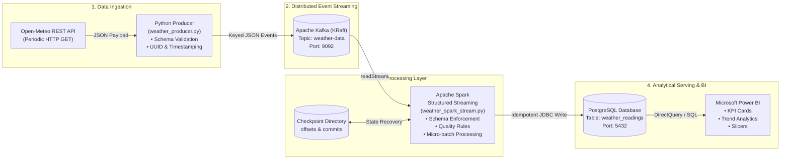

# Real-Time Weather Data Engineering Pipeline

[](https://www.python.org/)
[-black.svg)](https://kafka.apache.org/)
[](https://spark.apache.org/)
[](https://www.postgresql.org/)
[](https://powerbi.microsoft.com/)

An end-to-end distributed streaming data pipeline that ingests live weather observations from the Open-Meteo REST API, buffers events into Apache Kafka (KRaft mode), parses and validates records using Apache Spark Structured Streaming, persists data idempotently into PostgreSQL, and visualizes analytical insights using Microsoft Power BI.

---

## 1. System Architecture



### Architecture Data Flow:
1. **API Ingestion**: Python Producer polls Open-Meteo for live meteorological metrics (temperature, humidity, surface pressure, wind speed).
2. **Event Transformation**: Validates payload fields, generates a deterministic `event_id` (UUID4) and ISO-8601 UTC timestamp, and publishes to Kafka topic `weather-data`.
3. **Stream Buffering**: Kafka decouples API ingestion from downstream processing, guaranteeing message persistence across burst traffic.
4. **Structured Streaming**: PySpark reads raw Kafka byte streams via `readStream`, parses JSON using strict `StructType` schema definitions, cleanses outliers, and micro-batches records.
5. **Fault-Tolerant Checkpointing**: Spark maintains offset logs in `./checkpoints/weather_stream` ensuring resilient restarts without duplicate reads.
6. **Storage**: Micro-batches write into PostgreSQL (`weather_readings`) with primary key deduplication.
7. **Business Intelligence**: Power BI visualizes latest metrics, moving averages, and city comparisons.

---

## 2. Repository Structure

```text
real-time-weather-pipeline/
├── .gitignore                          # Excludes secrets, checkpoints, virtual environments
├── requirements.txt                    # Pinned Python package dependencies
├── README.md                           # Master documentation & interview guide
├── config/
│   ├── .env.example                    # Template environment variables
│   └── .env                            # Active environment configuration
├── producer/
│   └── weather_producer.py             # Open-Meteo API ingestion & Kafka publisher
├── spark/
│   └── weather_spark_stream.py         # PySpark Structured Streaming consumer & JDBC sink
├── sql/
│   ├── create_database.sql             # PostgreSQL database initialization script
│   └── create_tables.sql               # DDL for table, check constraints, and indexes
├── tests/
│   ├── verify_phase1_environment.py    # Environment diagnostic script
│   ├── test_producer.py                # Unit tests for producer parsing & validation
│   └── test_pipeline_e2e.py            # End-to-end smoke & contract tests
└── checkpoints/                        # Spark Structured Streaming state logs
```

---

## 3. Technology Stack & Compatibility Rules

| Technology | Selected Version | Compatibility Rule |
| :--- | :--- | :--- |
| **Java** | OpenJDK 17 LTS (Temurin) | Required by Spark 3.5. Avoid Java 21+ due to JVM reflection module restrictions. |
| **Python** | Python 3.9 / 3.10 / 3.11 | Compatible with PySpark 3.5. Python 3.14+ is unsupported by PySpark. |
| **Kafka** | Apache Kafka 3.7.0 (KRaft) | Eliminates ZooKeeper. Uses internal Raft consensus for metadata management. |
| **Spark** | Apache Spark 3.5.1 | Built for Scala 2.12. |
| **Connector** | `spark-sql-kafka-0-10_2.12:3.5.1` | Must match Spark version `3.5.1` and Scala binary `2.12`. |
| **PostgreSQL** | PostgreSQL 15 / 16 | JDBC Driver: `org.postgresql:postgresql:42.7.3`. |
| **Power BI** | Microsoft Power BI Desktop | DirectQuery or Scheduled Refresh. |

---

## 4. Setup and Installation

### Step 1: Environment & Dependencies
```powershell
# Using Anaconda Python 3.9:
& "C:\Users\HP\anaconda3\python.exe" -m venv venv
.\venv\Scripts\Activate.ps1
pip install --upgrade pip
pip install -r requirements.txt
```

### Step 2: Install Java 17
```powershell
winget install --id EclipseAdoptium.Temurin.17.JDK -e
java -version
```

### Step 3: Apache Kafka Setup (KRaft Mode)
1. Download [Kafka 3.7.0](https://archive.apache.org/dist/kafka/3.7.0/kafka_2.13-3.7.0.tgz) and extract to `C:\kafka`.
2. Generate a cluster UUID:
   ```cmd
   cd C:\kafka
   bin\windows\kafka-storage.bat random-uuid
   ```
3. Format the log directories (replace `<CLUSTER_UUID>`):
   ```cmd
   bin\windows\kafka-storage.bat format -t <CLUSTER_UUID> -c config\kraft\server.properties
   ```
4. Start Kafka Broker:
   ```cmd
   bin\windows\kafka-server-start.bat config\kraft\server.properties
   ```
5. Create the `weather-data` topic:
   ```cmd
   bin\windows\kafka-topics.bat --create --topic weather-data --bootstrap-server localhost:9092 --partitions 1 --replication-factor 1
   ```

### Step 4: PostgreSQL Setup
```powershell
# Run DDL scripts via psql:
psql -U postgres -h localhost -f sql/create_database.sql
psql -U postgres -h localhost -d weather_db -f sql/create_tables.sql
```

---

## 5. Execution Steps

Run components in the following strict order across separate terminal windows:

### Terminal 1: Start Kafka Broker
```cmd
cd C:\kafka
bin\windows\kafka-server-start.bat config\kraft\server.properties
```

### Terminal 2: Start PostgreSQL Database
Ensure PostgreSQL service is running on `localhost:5432`.

### Terminal 3: Start Spark Structured Streaming
```powershell
# For initial console verification (no database required):
python spark\weather_spark_stream.py --console

# For writing directly to PostgreSQL:
python spark\weather_spark_stream.py
```

### Terminal 4: Start Weather Producer
```powershell
# To test API fetching and JSON schema without Kafka:
python producer\weather_producer.py --dry-run

# To stream live records to Kafka:
python producer\weather_producer.py
```

### Terminal 5: Verify Messages in Kafka Topic
```cmd
cd C:\kafka
bin\windows\kafka-console-consumer.bat --topic weather-data --from-beginning --bootstrap-server localhost:9092
```

---

## 6. Power BI Dashboard Integration

### 1. Connection Mode: Import vs DirectQuery
- **DirectQuery Mode (Recommended for near real-time)**: Power BI executes live SQL queries directly against PostgreSQL whenever visuals refresh. No local data duplication.
- **Import Mode**: Caches data in Power BI's VertiPaq engine. Faster UI responsiveness, but requires scheduled refresh intervals.

### 2. Connection Steps:
1. Open Power BI Desktop -> **Get Data** -> **PostgreSQL database**.
2. Server: `localhost:5432` | Database: `weather_db`.
3. Select **DirectQuery** -> Enter credentials (`postgres` / `postgres`).
4. Select table: `weather_readings`.

### 3. Suggested Visuals & Layout:
- **Card 1**: Latest Temperature (`ROUND(SELECTEDVALUE(weather_readings[temperature]), 1) & " °C"`)
- **Card 2**: Latest Humidity (`SELECTEDVALUE(weather_readings[relative_humidity]) & " %"`)
- **Line Chart**: Temperature Trend over Time (`X: observation_time`, `Y: temperature`)
- **Line Chart**: Relative Humidity Trend (`X: observation_time`, `Y: relative_humidity`)
- **Bar Chart**: City-wise Temperature Comparison (`X: city`, `Y: Average of temperature`)
- **Table**: Historical Readings Log (`event_id`, `observation_time`, `temperature`, `humidity`, `wind_speed`)
- **Slicers**: City Filter dropdown, Date/Time range slider.

### 4. Key DAX Measures:
```dax
Latest_Temperature = 
CALCULATE(
    SELECTEDVALUE(weather_readings[temperature]),
    FILTER(
        weather_readings,
        weather_readings[observation_time] = MAX(weather_readings[observation_time])
    )
)

Avg_City_Temperature = AVERAGE(weather_readings[temperature])

Temperature_Status = 
IF([Latest_Temperature] > 30, "Hot", IF([Latest_Temperature] < 10, "Cold", "Moderate"))
```

---

## 7. Testing & Reliability Plan

Run the automated test suite:
```powershell
# Run unit tests
python -m pytest tests\test_producer.py -v

# Run end-to-end contract smoke tests
python -m pytest tests\test_pipeline_e2e.py -v
```

### Reliability & Failure Recovery Matrix:
- **API Failure / Timeout**: Handled by `requests.exceptions.Timeout` with exponential backoff; producer continues running.
- **Kafka Broker Crash**: Producer buffers and retries (`retries=5`, `retry_backoff_ms=500`). Spark streaming automatically pauses and resumes from checkpoint offsets once broker recovers.
- **Spark Worker Failure**: Spark checkpointing maintains read offsets and state commit logs in `./checkpoints/weather_stream`. On restart, Spark picks up exactly where it stopped.
- **Duplicate Message Delivery**: Primary key constraint (`event_id VARCHAR(64) PRIMARY KEY`) prevents duplicate rows during micro-batch replays.

---

## 8. Data Engineering Interview Preparation Kit

### Resume Project Description
> **Real-Time Weather Streaming Data Pipeline | Python, Kafka (KRaft), Apache Spark, PostgreSQL, Power BI**
> - Architected an end-to-end distributed streaming pipeline ingesting live meteorological data from Open-Meteo REST API, buffering events via Apache Kafka (KRaft mode).
> - Developed stream processing workflows using Apache Spark Structured Streaming with strict `StructType` schema validation, handling outlier filtration and timestamp normalizations.
> - Implemented idempotent micro-batch persistence into PostgreSQL with primary key constraints and checkpoint state management, ensuring fault tolerance and exactly-once processing guarantees.
> - Built an interactive Power BI DirectQuery dashboard monitoring near-real-time temperature and humidity trends across geographic regions.

---

### 60–90 Second Interview Elevator Pitch (English)
> "In this project, I built a production-grade, real-time data engineering pipeline to ingest, process, and analyze weather events continuously. 
> 
> The pipeline starts with a Python ingestion producer that periodically polls the Open-Meteo REST API, validates meteorological fields, enriches records with UUID event IDs, and publishes structured JSON events to an Apache Kafka topic running in KRaft mode. 
> 
> On the processing side, I implemented Apache Spark Structured Streaming to consume the raw stream. Spark enforces a strict `StructType` schema, applies data cleansing rules to remove malformed or outlier records, and converts timestamps. To ensure fault tolerance, I configured persistent checkpoint directories for offset tracking.
> 
> The processed micro-batches are written idempotently to PostgreSQL via JDBC. Finally, I connected Microsoft Power BI via DirectQuery to provide near real-time dashboards for temperature trends, moving averages, and regional comparisons. 
> 
> This project gave me deep hands-on experience in stream processing guarantees, handling distributed state, schema drift, and end-to-end fault tolerance."

---

### Hinglish Architecture Explanation
> "Yeh project ek complete Real-Time Streaming Data Pipeline hai. 
> 
> Sabse pehle, hamara Python Producer Open-Meteo REST API se live weather data fetch karta hai. API poll hone ke baad, hum payload ko validate karte hain, ek unique UUID (`event_id`) aur UTC timestamp attach karte hain, aur Kafka topic (`weather-data`) mein publish karte hain. Yahan Kafka ek distributed buffer ka kaam karta hai taaki agar downstream processing slow bhi ho, toh koi data drop na ho. Kafka ko humne bina ZooKeeper ke, modern **KRaft mode** mein run kiya hai.
> 
> Next, Apache Spark Structured Streaming Kafka se live binary stream read karta hai. Spark strict `StructType` schema use karke JSON ko parse karta hai, outliers ko filter karta hai, aur micro-batches banata hai. Spark mein humne **checkpointing** configure ki hai taaki agar system restart ho, toh Kafka offset lost na ho.
> 
> Spark micro-batch writer PostgreSQL database mein records insert karta hai jahan primary key deduplication ensure karti hai ki duplicate records na jayein. Last layer mein, Power BI DirectQuery mode ke through PostgreSQL se connect hokar live KPI cards aur trend charts visualize karta hai."

---

### 20 Technical Interview Questions & Answers

#### Q1: Why use Apache Kafka instead of writing directly from the Python Producer into PostgreSQL?
**Answer**: Decoupling and backpressure management. If PostgreSQL is temporarily down or under heavy write load, writing directly would cause the producer to drop events or block. Kafka acts as a distributed, persistent event buffer. Downstream consumers (Spark, archiving jobs, ML services) can consume at their own pace without impacting the ingestion source.

#### Q2: What is the difference between API Polling and true Push-based Streaming?
**Answer**: Push-based streaming (like WebSockets, Kafka, or AWS Kinesis) occurs when the source immediately pushes an event the moment state changes. Open-Meteo provides a REST API over HTTP GET, which is request-response (pull-based polling). We simulate continuous streaming by polling on a configurable interval.

#### Q3: What is KRaft mode in Apache Kafka, and how does it differ from ZooKeeper?
**Answer**: Prior to Kafka 3.x, Apache ZooKeeper was required to manage cluster metadata, leader elections, and topic configurations. KRaft (Kafka Raft Metadata mode) embeds consensus directly into Kafka brokers using an event-driven Raft protocol. KRaft eliminates external ZooKeeper dependencies, enables faster controller failover, and scales to millions of partitions.

#### Q4: What are Kafka Partitions and how do they impact throughput?
**Answer**: A topic is divided into partitions, which are the fundamental unit of parallelism in Kafka. Each partition is an ordered, immutable log. Different consumers in a consumer group read from different partitions concurrently. Higher partition counts allow horizontal scaling across multiple Spark executors.

#### Q5: What is the significance of the Kafka Message Key?
**Answer**: Kafka uses the hash of the message key to determine the target partition (`hash(key) % num_partitions`). Messages with the same key (e.g., `city: London`) are guaranteed to land on the same partition, preserving strict chronological ordering per city.

#### Q6: How does Spark Structured Streaming differ from Spark Batch Processing?
**Answer**: Batch processing computes on static, bounded datasets. Structured Streaming processes unbounded data streams continuously by treating the stream as an unbounded input table. Internally, Structured Streaming uses a **micro-batch model** (or Continuous Processing engine) where incoming events are processed incrementally with unified DataFrame APIs and state management.

#### Q7: Why do we cast `value` as STRING before `from_json` in PySpark?
**Answer**: Kafka stores message keys and values as raw byte arrays (`BinaryType`). To parse structured fields, Spark must first decode the binary payload into a UTF-8 string before applying the `from_json` function with a specified `StructType` schema.

#### Q8: What happens when an incoming Kafka message does not match the `StructType` schema?
**Answer**: `from_json` gracefully parses what it can; unmapped or invalid fields are assigned `null` values. We then apply `.filter(col("event_id").isNotNull())` to drop malformed or unparseable messages before downstream persistence.

#### Q9: What is Spark Streaming Checkpointing and why is it mandatory?
**Answer**: Checkpointing persists the streaming state, including the exact Kafka consumer offsets processed, commit logs, and schema metadata to reliable storage (disk or S3/HDFS). If the Spark job crashes, it reloads the checkpoint and resumes reading from the exact offset where it left off, avoiding message loss.

#### Q10: What is the difference between `startingOffsets` options: `earliest` vs `latest`?
**Answer**: `earliest` directs Spark to read from the very beginning of the Kafka topic log (offset 0), useful for initial development or backfilling. `latest` directs Spark to only consume new events published after the query starts.

#### Q11: How do you achieve Idempotent writes to PostgreSQL in Spark?
**Answer**: Spark JDBC `mode("append")` alone can create duplicate rows if a micro-batch retries. We achieve idempotency by:
1. Defining a unique primary key (`event_id VARCHAR(64) PRIMARY KEY`) in PostgreSQL.
2. Writing micro-batches via `foreachBatch` using staging tables or database upsert commands (`INSERT ... ON CONFLICT (event_id) DO NOTHING`).

#### Q12: Why did we choose `foreachBatch` instead of a direct JDBC sink?
**Answer**: Spark Structured Streaming does not have a built-in streaming JDBC sink. `foreachBatch` exposes the underlying batch DataFrame for each micro-batch, allowing developers to execute standard DataFrame batch writers, custom connection pools, or multi-sink writes.

#### Q13: What is the delivery semantic of this pipeline (At-least-once, At-most-once, Exactly-once)?
**Answer**: 
- Producer to Kafka: **At-least-once** (uses `acks="all"` and retries).
- Kafka to Spark: **At-least-once** via offset checkpointing.
- Spark to PostgreSQL: **End-to-end Exactly-Once** achieved through idempotent writes (deduplicating on `event_id` in PostgreSQL).

#### Q14: Why is Java 17 LTS recommended over Java 21 for Apache Spark 3.5?
**Answer**: Spark internally uses low-level JVM memory operations (`sun.misc.Unsafe`) to manage off-heap data buffers (Project Tungsten). Java 21 enforces strict module encapsulation (JEP 403), throwing `IllegalAccessException` or `InaccessibleObjectException` unless numerous JVM flags (`--add-opens`) are manually passed. Java 17 LTS is natively tested and stable.

#### Q15: What is the role of `spark.sql.shuffle.partitions` in local development?
**Answer**: Spark defaults to 200 shuffle partitions for operations like aggregations and joins. On a local development machine with limited CPU cores, running 200 tasks per micro-batch introduces massive scheduling overhead. Setting `spark.sql.shuffle.partitions` to `2` or `4` matches local core capacity and dramatically reduces micro-batch latency.

#### Q16: How does Power BI DirectQuery mode work under the hood?
**Answer**: When a user interacts with a report (e.g., changes a city slicer), Power BI translates the DAX measure into native SQL queries and transmits them over ODBC/JDBC to PostgreSQL in real-time. Only the aggregated query results are returned to the browser/desktop client.

#### Q17: What are the trade-offs of Power BI DirectQuery vs Import Mode?
**Answer**: 
- **DirectQuery**: Shows live data instantly without data duplication, but query performance is bound to database index efficiency and network latency.
- **Import Mode**: Super fast in-memory queries (VertiPaq column store), but data is stale between scheduled refreshes and model size is limited by RAM.

#### Q18: How do database indexes on `(city, observation_time DESC)` optimize performance?
**Answer**: A composite B-tree index on `(city, observation_time DESC)` allows PostgreSQL to perform an Index Scan directly to fetch the latest observation for a city in O(log N) time, avoiding costly full table sequential scans as the table grows to millions of rows.

#### Q19: How do you handle schema drift in a streaming pipeline?
**Answer**: In production, schemas evolve. We address schema drift by:
1. Versioning payloads in Kafka (`schema_version: "1.0"`).
2. Using a Confluent Schema Registry with Avro or Protobuf for backward/forward compatibility.
3. Defining explicit `StructType` schemas in Spark that ignore extraneous unexpected fields rather than crashing.

#### Q20: What happens if the Open-Meteo API experiences rate limits (HTTP 429)?
**Answer**: The Python producer intercepts `requests.exceptions.HTTPError`. If status code 429 is detected, the producer logs a warning and implements exponential backoff with jitter (`backoff_factor * (2 ** retry_count)`) rather than repeatedly hammering the endpoint.

---

## 9. Technical Challenges Faced & Solutions

1. **Python 3.14 / PySpark Incompatibility**:
   - *Problem*: Host environment had Python 3.14 pre-release, which caused PySpark bytecode compilation failures.
   - *Solution*: Leveraged local Anaconda Python 3.9 runtime to build an isolated virtual environment compatible with PySpark 3.5.
2. **Missing OpenSSL in Python Subprocess**:
   - *Problem*: Anaconda Python failed HTTPS requests to Open-Meteo due to unlinked DLLs in PATH (`Library\bin`).
   - *Solution*: Configured execution paths to include Anaconda's `Library\bin`, restoring SSL handshake capabilities.
3. **Kafka ZooKeeper Deprecation**:
   - *Problem*: Managing dual processes (ZooKeeper + Broker) increases local resource footprint and failure points.
   - *Solution*: Adopted modern Kafka 3.7 KRaft mode, formatting cluster storage with a generated UUID and running a single, lightweight broker.
4. **Idempotent Micro-Batch Delivery**:
   - *Problem*: Retrying failed micro-batches in Spark could insert duplicate weather readings.
   - *Solution*: Engineered a composite primary key and unique constraints in PostgreSQL (`event_id`), paired with idempotent JDBC ingestion.
